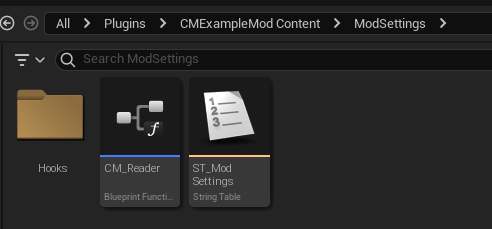
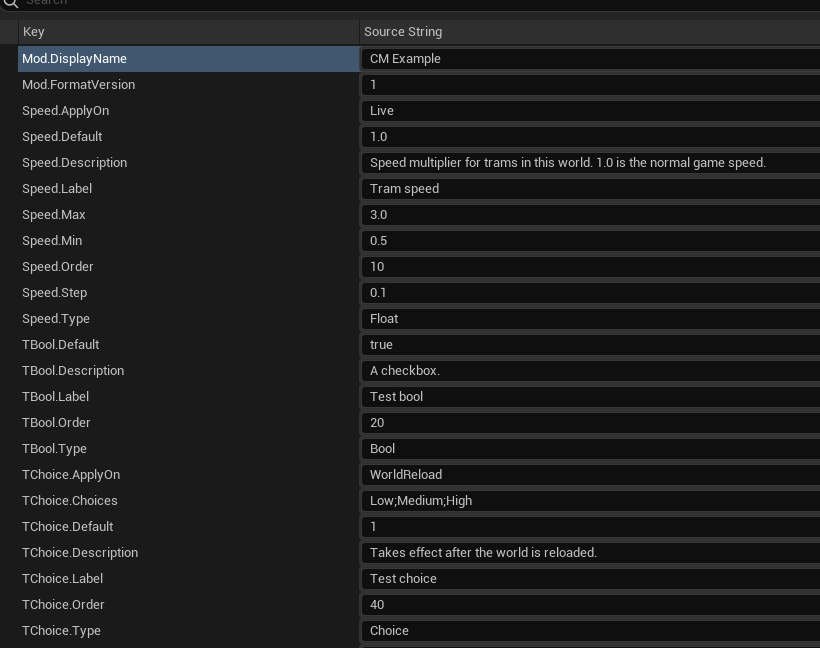
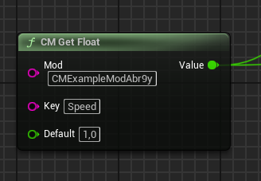
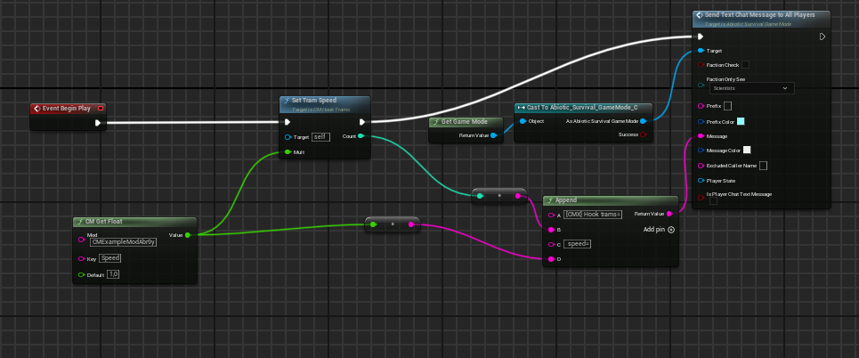

# Настройки своего мода через ConfigurationManager

[English version](AUTHORING.md)

ConfigurationManager даёт модам Abiotic Factor панель настроек в игре. Вы описываете настройки в String Table,
читаете их небольшой библиотекой функций, которую копируете в свой мод, и при желании поручаете менеджеру
применять их к миру.

ConfigurationManager — **необязательная** зависимость: ваш мод не ссылается ни на один ассет менеджера. Без
менеджера (или пока в мире не поставлен терминал настроек) читатель возвращает значения по умолчанию, которые вы
ему передаёте, а хуки не вызываются. Поэтому без менеджера мод работает, только если у него есть собственные акторы
, которые читают значения; мод, код которого выполняется только в хуках,
ничего не делает.

Полный рабочий пример — мод `CMExampleModAbr9y` в этом репозитории (`Examples/CMExampleModAbr9y`). В нём одна
настоящая настройка, `Speed`, она меняет скорость трамваев комплекса.



## Как это работает

- Игрок крафтит **терминал Configuration Manager** из одной доски (категория Construction), ставит его в мире и
  открывает панель взаимодействием с ним (кому это разрешено — см.
  [Кто может менять настройки](#кто-может-менять-настройки)).
- Менеджер находит все включённые моды, у которых есть `ModSettings/ST_ModSettings`, и показывает их настройки.
- Значения хранятся в терминале, у каждого мира свои. Они переживают сохранение, перезагрузку и упаковку терминала
  в предмет. Новый мир начинается с умолчаний.
- Сервер передаёт значения всем подключённым игрокам, поэтому в мире они у всех одинаковые.
- Ваш мод читает значения функциями `CM_Reader` или поручает менеджеру запускать ваши компоненты-хуки из
  `ModSettings/Hooks`.

## Шаг 1. Описание настроек

Создайте String Table `ModSettings/ST_ModSettings` в своём моде (Content Browser → Miscellaneous → String Table)
и заполните её через **Import from CSV** (заголовок `Key,SourceString`). Пример:

```csv
Key,SourceString
Mod.FormatVersion,1
Mod.DisplayName,My Mod
Speed.Type,Float
Speed.Default,1.0
Speed.Min,0.5
Speed.Max,3.0
Speed.Step,0.1
Speed.Label,Tram speed
Speed.Description,"Speed multiplier for trams in this world."
Speed.Order,10
```



| Ключ | Значение | Обязателен |
|---|---|---|
| `Mod.FormatVersion` | `1` | да |
| `Mod.DisplayName` | имя мода в панели | нет (по умолчанию — имя плагина) |
| `<Key>.Type` | `Bool` / `Int` / `Float` / `Choice` | да |
| `<Key>.Default` | Bool: `true`/`false` (или `1`/`0`); Int/Float: число; Choice: индекс варианта с `0` | да |
| `<Key>.Label` | подпись в панели | да |
| `<Key>.Description` | подсказка под подписью | нет |
| `<Key>.Min` / `<Key>.Max` | границы для Int/Float, `Min <= Max` | для Int/Float |
| `<Key>.Step` | шаг слайдера для Int/Float | нет |
| `<Key>.Choices` | варианты через `;`, например `Low;Medium;High` | для Choice |
| `<Key>.Order` | порядок в панели (по возрастанию) | нет |
| `<Key>.ApplyOn` | `Live` (по умолчанию) или `WorldReload` | нет |

Правила:
- `<Key>` — только латиница, цифры и `_`.
- Некорректная настройка (неизвестный тип, нет `Label`, `Min > Max`, `Choice` без вариантов и т.п.) молча
  пропускается, остальные работают.
- Если `Mod.FormatVersion` не `1`, таблица пропускается целиком, а мод без корректных настроек не получает кнопку в
  панели.
- Значения из панели ограничиваются `Min`/`Max` и выравниваются по `Step`.
- `ApplyOn = WorldReload` сейчас только добавляет в панели пометку «вступит в силу после перезагрузки мира». Менеджер
  не откладывает значение: читатель и хук видят новое значение сразу после «Применить».

## Шаг 2. Читатель

Скопируйте в свой мод ассет `CM_Reader` из примера (`Content/ModSettings/CM_Reader`) и скомпилируйте его. Это
Blueprint Function Library только на нодах движка, поэтому зависимости от менеджера он не создаёт.

## Шаг 3. Чтение значений

Вызывайте функции `CM_Reader` там, где нужно значение. Аргументы: id вашего мода, `<Key>` из таблицы и значение по
умолчанию.

| Функция | Возвращает |
|---|---|
| `CM_GetFloat(Mod, Key, Default)` | Float |
| `CM_GetInt(Mod, Key, Default)` | Int |
| `CM_GetBool(Mod, Key, Default)` | Bool |
| `CM_GetChoice(Mod, Key, Default)` | индекс варианта (Int) |
| `CM_GetRevision()` | номер ревизии настроек; `-1` — нет менеджера или терминала |

**Id мода** — имя папки вашего плагина в том виде, в каком его создал Mod Kit, вместе с добавленным суффиксом: у
примера это `CMExampleModAbr9y`, а не `CMExampleMod`. С него же начинаются пути к вашему контенту
(`/CMExampleModAbr9y/...`).

Пример: `CM_GetFloat("MyModAbc12", "Speed", 1.0)`.



Читатель работает на сервере, в одиночной игре и у клиентов в мультиплеере: каждый игрок получает значения,
которые применил сервер.

**Изменения на лету.** Настройки можно поменять в любой момент. Если значение нужно применить к миру (поменять
свойства игровых акторов и т.п.), используйте хук (шаг 4) — менеджер сам вызовет его при загрузке мира и после
каждого изменения. Если значение читается вашим собственным объектом, читайте его в момент использования (не каждый
кадр: внутри идёт поиск актора) или раз в ~1 с сравнивайте `CM_GetRevision()` с запомненным и перечитывайте при
изменении. Не читайте его один раз в `BeginPlay` своего объекта: терминал может загрузиться позже.

## Шаг 4. Хук: применение настроек к миру (необязательно)

У мода нет места, где его код выполнялся бы сам по себе: код работает только у того, что игрок поставил или
использует. Поэтому менеджер запускает ваш код сам — через хук, компонент, который он создаёт.

1. Создайте в папке `ModSettings` папку `Hooks` и в ней **Blueprint Class → ActorComponent**:
   `/<id мода>/ModSettings/Hooks/<любое имя>`. Хуков может быть сколько угодно, имена любые; хуком считается каждый
   Blueprint `ActorComponent` прямо в `Hooks` (подпапки не просматриваются, другие ассеты пропускаются). Хуки ищутся
   только у модов, в `ModSettings/ST_ModSettings` которых есть хотя бы одна корректная настройка.
2. В Class Defaults выключите **Start with Tick Enabled** и **Component Replicates**.
3. В **Event Begin Play** прочитайте значения через `CM_Reader` и примените их. Записывайте абсолютные значения
   (`база × множитель`), никогда не умножайте текущее: `BeginPlay` вызывается много раз.

В примере два хука. `Hooks/CM_HookTrams` находит все трамваи и выставляет им скорость (`SetTramSpeed` — функция
внутри хука: цикл по `GetAllActorsOfClass(Tram_ParentBP)`, `TramSpeed = 500 × Mult`,
`TramSpeedUnattended = 1500 × Mult`); `Hooks/CM_HookLog` только пишет в чат настройку `TBool`:



`BeginPlay` каждого хука вызывается:
- при загрузке мира, где стоит терминал настроек;
- после каждого **«Применить»** в панели (старые хуки удаляются, создаются новые);
- при постановке терминала и при разборе терминала, на котором висят хуки, если в мире остался другой терминал;
- у клиента в мультиплеере: когда клиент получает терминал (при подключении или когда терминал появляется в мире) и
  каждый раз, когда с сервера приходят новые значения.

Правила:
- Хуки работают **на сервере и у каждого клиента** (и в одиночной игре), каждая машина создаёт свои компоненты-хуки.
  Если хук меняет то, что игра реплицирует с сервера (свойства акторов, которые выставляет сервер, предметы,
  состояние мира), делайте эту часть только на сервере: **Switch Has Authority → Authority**. То, что каждая машина
  считает сама, можно выставлять везде. Порядок запуска хуков не определён.
- Хук висит на терминале, но **не обращайтесь к владельцу** (`Get Owner → Cast To …Terminal`): иначе ваш мод
  начнёт зависеть от менеджера.
- **Event End Play** необязателен. Если его нет, после разбора последнего терминала применённые значения действуют
  до перезагрузки мира. Если хотите, чтобы эффект пропадал сразу, верните в `End Play` умолчания игры. `End Play`
  вызывается и при пересоздании хука после «Применить» — сразу перед новым `BeginPlay`.
- Без менеджера или без терминала в мире хук не вызывается — игра остаётся на своих умолчаниях.

## Кто может менять настройки

- **Одиночная игра и хост listen-сервера** — всегда.
- **Админы (модераторы) сервера** — всегда. На выделенном сервере игрок — модератор, если его SteamID64 записан в
  `AbioticFactor\Saved\SaveGames\Server\Admin.ini` (`[Moderators]`, `Moderator=<SteamID64>`) или после входа админа
  средствами игры.
- **Остальные игроки** — только если включено **Allow clients to change settings**. Это настройка самого менеджера:
  она в панели в разделе **Configuration Manager**, по умолчанию выключена, менять её может только хост или админ.
- Игрок без прав панель не откроет; при взаимодействии с терминалом ничего не происходит.

## Проверка

Менеджер не пишет сообщений ни в чат, ни в лог. Чтобы проверить таблицу, поставьте терминал и откройте панель:
- у вашего мода есть кнопка, рядом — число корректных настроек;
- в списке есть все описанные настройки; если какой-то нет, она пропущена из-за ошибки в её ключах;
- кнопки нет — таблица не найдена или в ней нет корректных настроек (`Mod.FormatVersion`, путь
  `ModSettings/ST_ModSettings`).

Чтобы проверить читатель или хук, на время отладки выводите значение в чат (`Get Game Mode → Cast To
Abiotic_Survival_GameMode → Send Text Chat Message To All Players`, работает на сервере; `Print String` в релизной
игре не виден). Сообщения чата попадают и в лог игры `%LOCALAPPDATA%\AbioticFactor\Saved\Logs\AbioticFactor.log`
(строки с `CHAT LOG:`).

## Ограничения текущей версии

- `ApplyOn = WorldReload` — только пометка в панели (см. шаг 1).
- Без установленного менеджера или без терминала в мире мод работает только через собственные акторы (с
  умолчаниями). Мод без собственных акторов, код которого выполняется только в хуках, не работает.
