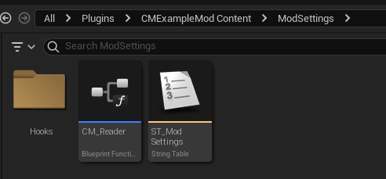
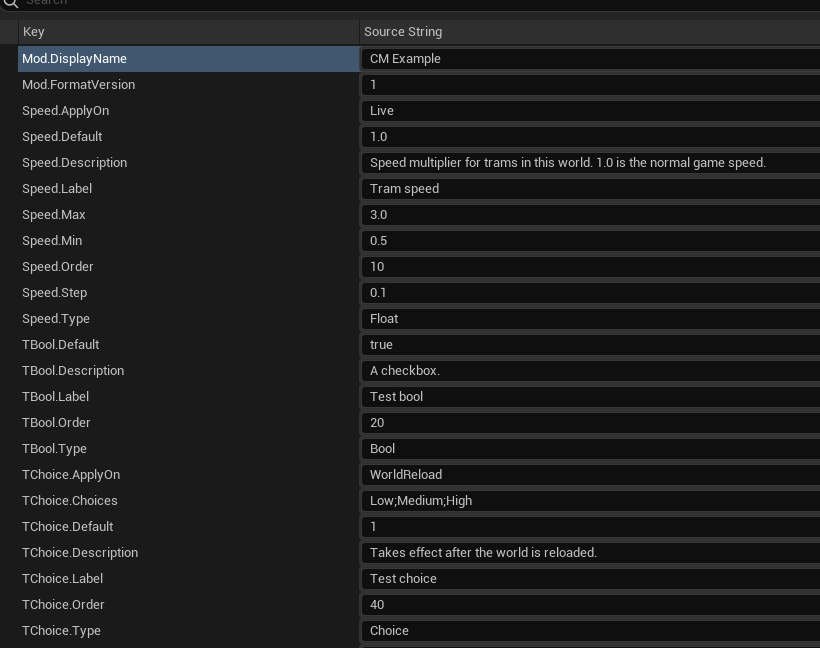
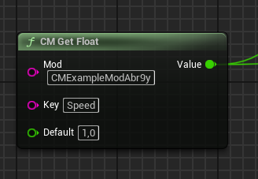
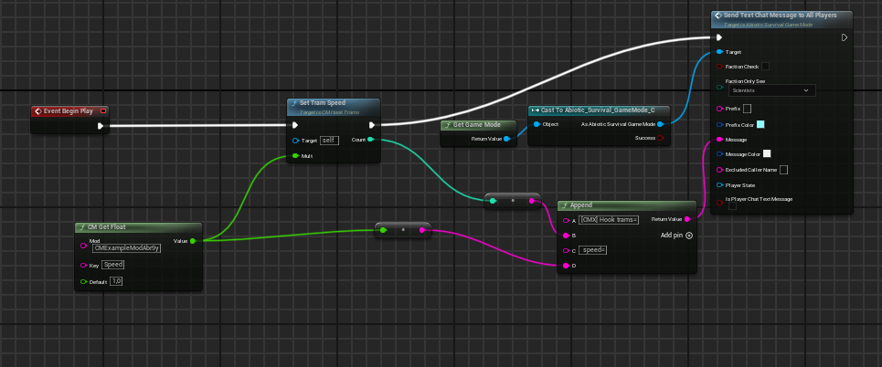

# Adding settings to your mod with ConfigurationManager

[Русская версия](README.ru.md)

ConfigurationManager gives Abiotic Factor mods an in-game settings panel. You describe your settings in a String
Table, read them with a small function library you copy into your mod, and optionally let the manager apply them
to the world for you.

ConfigurationManager is an **optional** dependency: your mod does not reference any manager asset. Without the
manager (or while no settings terminal is placed in the world) the reader returns the default values you pass to it,
and hooks are not called. So a mod keeps working without the manager only if it has its own actors (things the player
places or uses) that read the values; a mod whose code runs only in hooks does nothing.

A complete working example is the `CMExampleModAbr9y` mod in this repository (`Examples/CMExampleModAbr9y`). It has
one real setting, `Speed`, which changes the speed of the facility trams.



## How it works

- A player crafts the **Configuration Manager terminal** from one wood plank (Construction category), places it in
  the world and opens the panel by interacting with it (who may open it: see
  [Who can change settings](#who-can-change-settings)).
- The manager finds every enabled mod that has `ModSettings/ST_ModSettings` and shows its settings.
- Values are stored in the terminal, per world. They survive saving, reloading and packing the terminal into an
  item. A new world starts with defaults.
- The server sends the values to every connected player, so they are the same for everyone in the world.
- Your mod reads values with `CM_Reader` functions, or lets the manager run your hook components from
  `ModSettings/Hooks`.

## Step 1. Describe your settings

Create a String Table `ModSettings/ST_ModSettings` in your mod (Content Browser → Miscellaneous → String Table) and
fill it with **Import from CSV** (header `Key,SourceString`). Example:

```csv
Key,SourceString
Mod.FormatVersion,1
Mod.DisplayName,My Mod
Speed.Type,Float
Speed.Default,1.0
Speed.Min,0.5
Speed.Max,3.0
Speed.Step,0.1
Speed.Label,Tram speed
Speed.Description,"Speed multiplier for trams in this world."
Speed.Order,10
```



| Key | Value | Required |
|---|---|---|
| `Mod.FormatVersion` | `1` | yes |
| `Mod.DisplayName` | mod name shown in the panel | no (defaults to the plugin name) |
| `<Key>.Type` | `Bool` / `Int` / `Float` / `Choice` | yes |
| `<Key>.Default` | Bool: `true`/`false` (or `1`/`0`); Int/Float: a number; Choice: option index from `0` | yes |
| `<Key>.Label` | label in the panel | yes |
| `<Key>.Description` | hint under the label | no |
| `<Key>.Min` / `<Key>.Max` | limits for Int/Float, `Min <= Max` | for Int/Float |
| `<Key>.Step` | slider step for Int/Float | no |
| `<Key>.Choices` | options separated by `;`, e.g. `Low;Medium;High` | for Choice |
| `<Key>.Order` | position in the panel (ascending) | no |
| `<Key>.ApplyOn` | `Live` (default) or `WorldReload` | no |

Rules:
- `<Key>` uses Latin letters, digits and `_` only.
- A broken setting (unknown type, missing `Label`, `Min > Max`, a `Choice` without options and so on) is skipped
  silently; the other settings work.
- If `Mod.FormatVersion` is not `1`, the whole table is skipped, and a mod without valid settings gets no button in
  the panel.
- Values entered in the panel are clamped to `Min`/`Max` and snapped to `Step`.
- `ApplyOn = WorldReload` currently only adds the note "takes effect after the world is reloaded" in the panel. The
  manager does not delay the value: readers and the hook see the new value right after Apply.

## Step 2. Copy the reader

Copy the `CM_Reader` asset from the example (`Content/ModSettings/CM_Reader`) into your mod and compile it. It is a
Blueprint Function Library that uses only engine nodes, so it does not create a dependency on the manager.

## Step 3. Read values

Call the `CM_Reader` functions where you need a value. Arguments: your mod id, the `<Key>` from the table, and the
default value.

| Function | Returns |
|---|---|
| `CM_GetFloat(Mod, Key, Default)` | Float |
| `CM_GetInt(Mod, Key, Default)` | Int |
| `CM_GetBool(Mod, Key, Default)` | Bool |
| `CM_GetChoice(Mod, Key, Default)` | option index (Int) |
| `CM_GetRevision()` | settings revision number; `-1` means no manager or no terminal |

**Mod id** is the name of your plugin folder as the Mod Kit created it, including the generated suffix — for the
example it is `CMExampleModAbr9y`, not `CMExampleMod`. It is also the root of your content paths
(`/CMExampleModAbr9y/...`).

Example: `CM_GetFloat("MyModAbc12", "Speed", 1.0)`.



The reader works on the server, in single player and on multiplayer clients: every player gets the values the
server applied.

**Changes during play.** Settings can be changed at any time. If the value must be applied to the world
(changing properties of game actors and so on), use a hook (step 4) — the manager calls it when the world loads and
after every change. If the value is used by your own object, read it at the moment of use (not every frame: the
reader searches for an actor) or compare `CM_GetRevision()` with a remembered value about once per second and re-read
on change. Do not read it only once in your object's `BeginPlay`: the terminal may load later than your object.

## Step 4. Hook: applying settings to the world (optional)

A mod has no place where its code runs on its own: code only runs in things the player places or uses. So the
manager runs your code for you through a hook — a component it creates itself.

1. Create a folder `Hooks` inside your `ModSettings` folder and create **Blueprint Class → ActorComponent** there:
   `/<mod id>/ModSettings/Hooks/<any name>`. You can have as many hooks as you like, with any names; every
   `ActorComponent` Blueprint directly in `Hooks` is a hook (subfolders are not searched, other assets are skipped).
   Hooks are only looked for in mods whose `ModSettings/ST_ModSettings` has at least one valid setting.
2. In Class Defaults turn off **Start with Tick Enabled** and **Component Replicates**.
3. In **Event Begin Play** read your values with `CM_Reader` and apply them. Write absolute values
   (`base × multiplier`), never multiply the current value: `BeginPlay` runs many times.

The example has two hooks. `Hooks/CM_HookTrams` finds all trams and sets their speed (`SetTramSpeed` is a function
inside the hook that loops over `GetAllActorsOfClass(Tram_ParentBP)` and sets `TramSpeed = 500 × Mult`,
`TramSpeedUnattended = 1500 × Mult`); `Hooks/CM_HookLog` only writes the `TBool` setting to the chat:



`BeginPlay` of every hook runs:
- when a world with a settings terminal is loaded;
- after every **Apply** in the panel (the old hooks are removed and new ones are created);
- when a terminal is placed, and when the terminal that carries the hooks is removed while another terminal remains;
- on a multiplayer client: when the client receives the terminal (on joining or when it comes into the world) and
  every time new values arrive from the server.

Rules:
- Hooks run **on the server and on every client** (and in single player), each machine creates its own hook
  components. If your hook changes something the game replicates from the server (actor properties set on the
  server, items, world state), do that part only on the server: **Switch Has Authority → Authority**. Things each
  machine computes locally can be set everywhere. The order in which hooks run is not defined.
- The hook is attached to the terminal, but **do not access its owner** (`Get Owner → Cast To …Terminal`): that would
  make your mod depend on the manager.
- **Event End Play** is optional. Without it, after the last terminal is removed the applied values stay until the
  world is reloaded. If you want the effect to disappear immediately, restore the game defaults in `End Play`.
  `End Play` also runs when the hook is recreated after Apply, right before the new `BeginPlay`.
- Without the manager, or without a terminal in the world, the hook is never called and the game keeps its own
  defaults.

## Who can change settings

- **Single player and the host of a listen server** — always.
- **Server admins (moderators)** — always. On a dedicated server a player is a moderator when their SteamID64 is
  listed in `AbioticFactor\Saved\SaveGames\Server\Admin.ini` (`[Moderators]`, `Moderator=<SteamID64>`) or after the
  game's admin login.
- **Other players** — only when **Allow clients to change settings** is on. This is the manager's own setting: it is
  in the panel under **Configuration Manager**, off by default, and only the host or an admin can change it.
- A player without rights cannot open the panel; nothing is shown when they use the terminal.

## Checking your mod

The manager does not write messages to the chat or the log. To check your table, place the terminal and open the
panel:
- your mod has a button with the number of valid settings next to it;
- every setting you described is in the list; a missing setting was skipped because of an error in its keys;
- no button means the table was not found or has no valid settings (`Mod.FormatVersion`, path
  `ModSettings/ST_ModSettings`).

To check the reader or a hook, write the value to the chat while testing (`Get Game Mode → Cast To
Abiotic_Survival_GameMode → Send Text Chat Message To All Players`, works on the server; `Print String` is not shown
in the release game). The chat messages also go to the game log
`%LOCALAPPDATA%\AbioticFactor\Saved\Logs\AbioticFactor.log` (lines with `CHAT LOG:`).

## Current limitations

- `ApplyOn = WorldReload` is only a note in the panel (see Step 1).
- Without the manager installed, or without a terminal in the world, a mod works only through its own actors (with
  default values). A mod without its own actors, whose code runs only in hooks, does not work.
